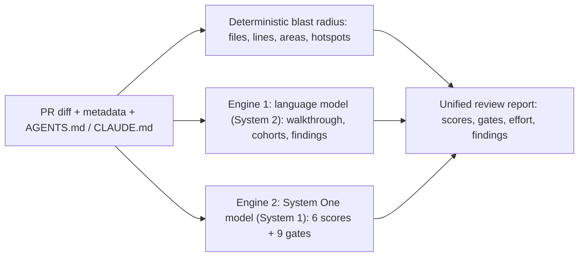

Asking one chat model to write a nuanced critique *and* output calibrated numeric scores fails in practice: chat models cluster every score between 75 and 85, and generation slows down.

CodeOtter splits a review into **two specialised engines that run concurrently**:

Both engines run in parallel, so a review takes only as long as the slower pass. Either engine can also run on its own.

## System 2: language model

Writes the human-readable review:

- **Executive walkthrough**: what changed, how the commits progressed, and whether linked issue requirements (`Closes #123`, `Fixes #456`) are met.
- **File cohorts**: related file changes grouped into review units.
- **Actionable findings**: ranked by severity (High / Major, Medium / Minor, Low / Refactor, Nitpick).

Configure it with a [BYOK provider](/docs/byok-config) or a [local GGUF model](/docs/local-gguf-sidecar).

## System 1: System One model

Evaluates structured rubrics and merge-policy criteria in one fast pass (`POST /v1/systemone`):

- **6 calibrated scores (0–100)**: `Quality`, `Blast Radius`, `Correctness Risk`, `Test Coverage`, `Readability` and `PR Hygiene`.
- **9 pre-merge gates**: `Title`, `Description`, `Security` (injection, auth bypass, secrets, SSRF, XSS), `Complexity`, `Tests`, `Documentation`, `Scope`, `Repository guidelines` ([`AGENTS.md` / `CLAUDE.md`](/docs/repository-guidelines)) and `Issue requirements` (the diff checked against the linked issue's acceptance criteria).

<Callout type="warn" title="Scores come from a model or not at all">
  A System One model that fails to start, errors or skips a question fails the review, with the model's error on the
  review page, and nothing is posted to the PR. A language model that owns the scores must return all of them.
</Callout>

## Auto-review

Turn on **Auto-review** in a repository's **Repository settings** (under the repository in the sidebar). Every new or updated pull request then gets a full review with scores and the review comment posted, one PR at a time, on the same poll as triage. Drafts and PRs labelled `codeotter:skip` are skipped, and each head commit is reviewed once.

## Fast triage

System One rates each new or updated pull request's correctness risk and blast radius from a digest of the whole change and sets the `codeotter/triage` commit status in about 80 seconds on CPU with Kev 0.8B. A CI job can wait for it and stop the long build early. See [Fast triage in CI](/docs/ci-triage).
